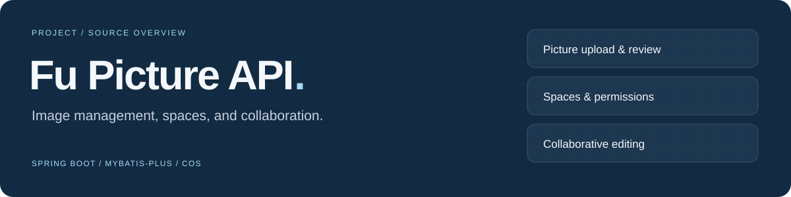
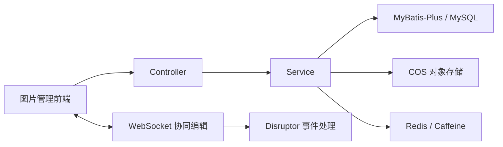

# Fu Picture Backend



**图片管理应用后端：上传、审核、空间、成员权限与协同编辑。**

[配套前端](https://github.com/dailyun/fu-picture-frontend) · [控制器](src/main/java/com/dali/fupicturebackend/controller/) · [建表脚本](create_table.sql) · [接口示例](httpTest/)

## 模块导航

| 模块 | 源码中的能力 | 入口 |
| --- | --- | --- |
| 图片 | 文件与 URL 上传、批量上传、筛选、审核 | [PictureController](src/main/java/com/dali/fupicturebackend/controller/PictureController.java) |
| 空间 | 创建、查询与编辑空间 | [SpaceController](src/main/java/com/dali/fupicturebackend/controller/SpaceController.java) |
| 成员 | 空间成员与角色管理 | [SpaceUserController](src/main/java/com/dali/fupicturebackend/controller/SpaceUserController.java) |
| 用户 | 注册、登录与用户管理 | [UserController](src/main/java/com/dali/fupicturebackend/controller/UserController.java) |
| 上传存储 | 文件处理与 COS 对接 | [上传模板](src/main/java/com/dali/fupicturebackend/manager/upload/) |
| 协同编辑 | WebSocket 与 Disruptor 事件处理 | [协同模块](src/main/java/com/dali/fupicturebackend/manager/websocket/) |

## 架构



## 项目配置

依赖以 [pom.xml](pom.xml) 为准：Spring Boot **2.7.6**、MyBatis-Plus、MySQL、Redis、Caffeine、腾讯云 COS、Sa-Token、WebSocket 与 Disruptor。Maven 的源码与目标版本配置为 Java 1.8；实际运行 JDK 还需满足所有依赖的要求。

[create_table.sql](create_table.sql)包含 `user`、`picture`、`space` 和 `space_user` 四张表。

## 本地启动

准备 Maven、满足依赖要求的 JDK、MySQL、Redis 和 COS 配置；先检查建表脚本，再在自己的开发数据库初始化。对象存储配置项见 [CosClientConfig](src/main/java/com/dali/fupicturebackend/config/CosClientConfig.java)，凭据应保存在本机私有配置中。

```bash
mvn spring-boot:run
```

服务地址和端口取决于本机配置。前端请求基址需要与后端一致；接口调用示例可参考 [httpTest](httpTest/)。

## English overview

Backend for the companion image-management frontend. The source includes picture uploads and review, spaces, member roles, COS storage integration, and WebSocket collaboration. Use the linked implementation map and Maven configuration when exploring or adapting the project.
